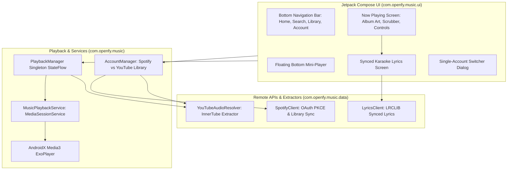

# Openfy 🎵 (Android)

<p align="center">
  
</p>

<p align="center">
  <strong>A music streaming application for Android mobile phones, looking just like Spotify with the power of RVX YouTube Music under the hood.</strong>
</p>

<p align="center">
  <a href="https://github.com/Zcross091/Openfy/actions/workflows/build.yml">
    
  </a>
  <a href="https://github.com/Zcross091/Openfy/releases/tag/latest">
    
  </a>
  
  
  
  
  
</p>

<p align="center">
  <a href="https://github.com/Zcross091/Openfy/releases/latest/download/Openfy.apk">
    
  </a>
</p>

---

## 📥 Download & Install

You can download the latest automated build directly from GitHub Releases:
* **Direct Download**: [**Download Openfy.apk**](https://github.com/Zcross091/Openfy/releases/latest/download/Openfy.apk)
* **Latest Release Hub**: [GitHub Releases (Tag: `latest`)](https://github.com/Zcross091/Openfy/releases/tag/latest)

> **In-Place APK Updates Supported**: Every build is signed with a persistent cryptographic release certificate (`SHA-256: 74:E6:5E:24:...`). You can install new APK versions directly on top of previous versions without uninstalling or losing your cached data.

---

## 🌟 Highlights

**Openfy** is a pure, native **Android application** that merges Spotify's mobile user interface with the unrestricted, ad-free audio streaming engine of RVX (ReVanced Extended) YouTube Music.

* **🎨 1:1 Spotify Mobile Interface**: Built entirely with **Jetpack Compose** and Material 3. Exact Spotify dark palette (`#121212`, card `#181818`, hover `#282828`, green accent `#1DB954`), mobile bottom navigation bar (`Home`, `Search`, `Your Library`, `Active Account`), persistent floating mini-player, and full-screen now-playing sheet.
* **⚡ RVX YouTube Music Streaming Engine**: High-fidelity Opus (160 kbps) and AAC (128 kbps) audio extraction using YouTube Music's InnerTube API. No ads, no song skips limits, and no Spotify Premium or YouTube Premium required.
* **🎧 Background Playback & Lock Screen Controls**: Powered by **AndroidX Media3 (ExoPlayer)** and a native `MediaSessionService`. Keeps playing seamlessly in the background with lock-screen controls, Android system notification controls (MediaStyle), and audio focus handling.
* **🔄 Single-Active-Account Paradigm**: Log in from your **Spotify** or **YouTube Music** account (one at a time):
  * **Logged into Spotify**: Access your Spotify Liked Songs and playlists. Tapping the **Heart** icon while listening immediately saves the song directly to your Spotify library (`PUT /v1/me/tracks`)!
  * **Logged into YouTube**: Access your YouTube Music playlists and Liked Music (`LM`). Tapping the **Heart** icon likes the song on YouTube Music!
  * **Guest / Free Mode**: Search, browse global top charts, and stream full songs without logging into anything.
* **🎤 Synchronized Karaoke Lyrics**: Fullscreen real-time synced lyrics with line-by-line autoscroll and click-to-seek, powered by LRCLIB.

---

## 🏗️ Architecture



---

## 🛠️ Building the APK

### Prerequisites
* **Android SDK**: API 35 (installed)
* **JDK**: Java 21 or Java 17
* **Gradle**: 8.12 (via Gradle Wrapper included)

### Build Debug APK
```bash
./gradlew assembleDebug
```
The compiled APK will be generated at:
`app/build/outputs/apk/debug/app-debug.apk`

---

## 📂 Project Structure

```
Openfy/
├── .gitignore
├── README.md
├── build.gradle.kts                      # Root Gradle build configuration
├── settings.gradle.kts                   # Project module dependencies
├── gradle.properties                     # JVM & AndroidX settings
├── gradlew / gradlew.bat                 # Gradle wrapper scripts
├── gradle/
│   ├── libs.versions.toml                # Android version catalog
│   └── wrapper/
│       ├── gradle-wrapper.jar
│       └── gradle-wrapper.properties
└── app/
    ├── build.gradle.kts                  # App module Gradle configuration
    ├── proguard-rules.pro
    └── src/
        └── main/
            ├── AndroidManifest.xml       # Foreground media service & permissions
            ├── res/                      # Drawables, colors, strings, themes
            └── java/com/openfy/music/
                ├── MainActivity.kt       # Root Compose activity
                ├── OpenfyApplication.kt  # Android application class
                ├── data/
                │   ├── AccountManager.kt # Single-active-account & like sync
                │   ├── model/            # Track, Album, Artist, Playlist, Lyrics
                │   └── remote/
                │       ├── YouTubeAudioResolver.kt # RVX InnerTube audio extractor
                │       ├── SpotifyClient.kt        # Spotify Web API PKCE & library
                │       └── LyricsClient.kt         # Synced lyrics fetcher
                ├── player/
                │   └── PlaybackManager.kt# ExoPlayer state & queue manager
                ├── service/
                │   └── MusicService.kt   # AndroidX MediaSessionService
                └── ui/
                    ├── components/       # MiniPlayer, NowPlaying, Nav, Lyrics
                    ├── screens/          # HomeScreen, SearchScreen, LikedSongsScreen
                    └── theme/            # Spotify dark theme palette & typography
```

---

## 📜 License

MIT License. Built for educational and personal research purposes.
