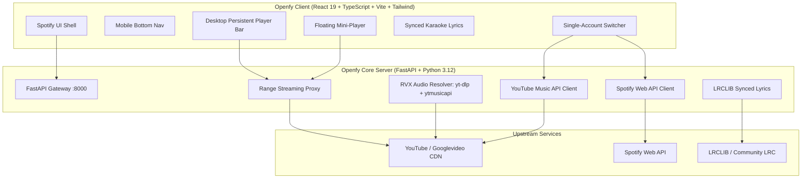

# Openfy 🎵

<p align="center">
  
</p>

<p align="center">
  <strong>A music streaming application for mobile phones and desktop, looking just like Spotify with the power of RVX YouTube Music under the hood.</strong>
</p>

<p align="center">
  
  
  
  
  
  
</p>

---

## 🌟 Highlights

**Openfy** merges Spotify's iconic user interface with the unrestricted, ad-free audio streaming engine of RVX (ReVanced Extended) YouTube Music.

* **🎨 1:1 Spotify Interface**: Exact Spotify typography, dark mode palette (`#121212`, card `#181818`, hover `#282828`, green accent `#1DB954`), persistent bottom player bar, sidebar, and hero gradient banners.
* **📱 Mobile-First Design**: Dedicated mobile bottom navigation bar, floating mini-player, and full-screen now-playing sheet with lock-screen MediaSession integration.
* **⚡ RVX Audio Streaming Engine**: Streams high-fidelity Opus (160 kbps) and AAC (128 kbps) audio without ads, without track limits, and without requiring Spotify Premium or YouTube Premium.
* **🔄 Single-Active-Account Architecture**: Log in from your **Spotify** account or **YouTube Music** account (one at a time):
  * **Logged into Spotify**: Access your Spotify Liked Songs and playlists. Tapping the **Heart** icon while listening immediately saves the song directly to your Spotify library (`PUT /v1/me/tracks`)!
  * **Logged into YouTube**: Access your YouTube Music playlists and Liked Music (`LM`). Tapping the **Heart** icon likes the song on YouTube Music!
  * **Guest / Free Mode**: Search, browse global top charts, and stream full songs without logging into anything.
* **🎤 Synchronized Karaoke Lyrics**: Real-time auto-scrolling synced lyrics with glowing active line highlighting and click-to-seek.
* **🎛️ Media Controls & OS Integration**: Background audio playback, lock screen media controls, and keyboard media keys (Play/Pause, Next, Prev) with album artwork display.

---

## 🏗️ Architecture



---

## 🚀 Quick Start

### Prerequisites
* **Python**: 3.10+ (tested on Python 3.12)
* **Node.js**: 18+ (tested on Node 26 & npm 11)

### 1. Clone the Repository
```bash
git clone https://github.com/Zcross091/Openfy.git
cd Openfy
```

### 2. Install Backend Dependencies
```bash
cd backend
pip install -r requirements.txt
cd ..
```

### 3. Install Frontend Dependencies
```bash
cd frontend
npm install
cd ..
```

### 4. Run Openfy
On Windows, simply double click **`start.bat`** (or run `.\start.ps1` in PowerShell).

Or run each service manually:
```bash
# Terminal 1: Backend
set PYTHONPATH=backend
python -m uvicorn app.main:app --host 127.0.0.1 --port 8000 --reload

# Terminal 2: Frontend
cd frontend
npm run dev
```

Visit **`http://localhost:5173`** in your browser or mobile phone on the same Wi-Fi network!

---

## 📂 Project Structure

```
Openfy/
├── backend/
│   ├── app/
│   │   ├── main.py               # FastAPI application entrypoint & API routes
│   │   ├── config.py             # App configuration & CORS settings
│   │   ├── models/
│   │   │   └── schemas.py        # Pydantic schemas (Track, Playlist, Auth)
│   │   └── services/
│   │       ├── audio_resolver.py # RVX-style YouTube Music stream extraction
│   │       ├── spotify_service.py# Spotify OAuth PKCE & Library sync
│   │       ├── ytmusic_service.py# YouTube Music OAuth & Library sync
│   │       ├── lyrics_service.py # Synchronized karaoke lyrics fetcher
│   │       └── cache_manager.py  # In-memory and stream caching
│   ├── tests/
│   │   └── test_api.py           # Backend unit tests
│   └── requirements.txt
├── frontend/
│   ├── src/
│   │   ├── components/
│   │   │   ├── layout/           # Sidebar, TopBar, PlayerBar, MobileNav
│   │   │   ├── views/            # HomeView, SearchView, LikedSongsView, PlaylistView
│   │   │   ├── modals/           # AccountSwitcherModal, LyricsView, NowPlayingModal, QueueModal
│   │   │   └── ui/               # TrackRow, Card
│   │   ├── context/
│   │   │   ├── AudioPlayerContext.tsx # Playback, queue, and volume engine
│   │   │   └── AuthContext.tsx        # Active account & library sync state
│   │   ├── services/
│   │   │   └── api.ts            # Client HTTP communication
│   │   ├── types/
│   │   │   └── index.ts          # TypeScript domain definitions
│   │   ├── App.tsx               # Root component
│   │   ├── index.css             # Tailwind setup and custom Spotify dark theme
│   │   └── main.tsx              # React entrypoint
│   ├── package.json
│   ├── tailwind.config.js
│   ├── tsconfig.json
│   └── vite.config.ts
├── start.bat                     # Windows one-click launcher
├── start.ps1                     # PowerShell launcher
├── .gitignore
└── README.md
```

---

## 🔒 Security & Privacy

* **Direct Client PKCE**: Spotify authentication uses the official OAuth 2.0 PKCE protocol without hardcoding sensitive secrets in public code.
* **No Telemetry / No Tracking**: Unlike official apps, Openfy does not track your listening behavior or inject third-party advertisements.
* **Safe Storage**: Sessions and tokens are stored locally on your device.

---

## 📜 License

MIT License. Built for educational and personal research purposes. All music rights belong to their respective copyright holders.
