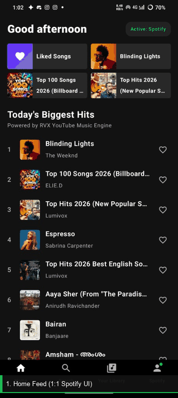
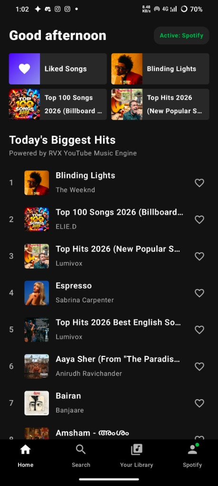
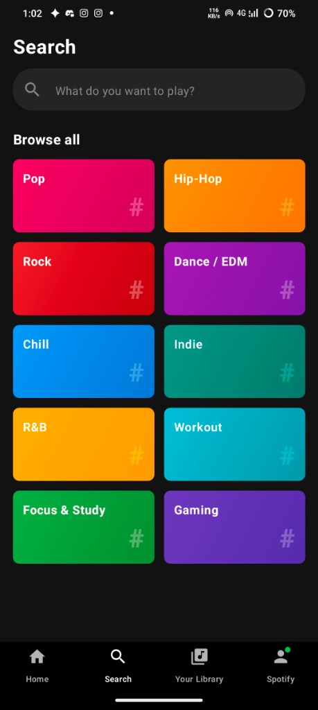
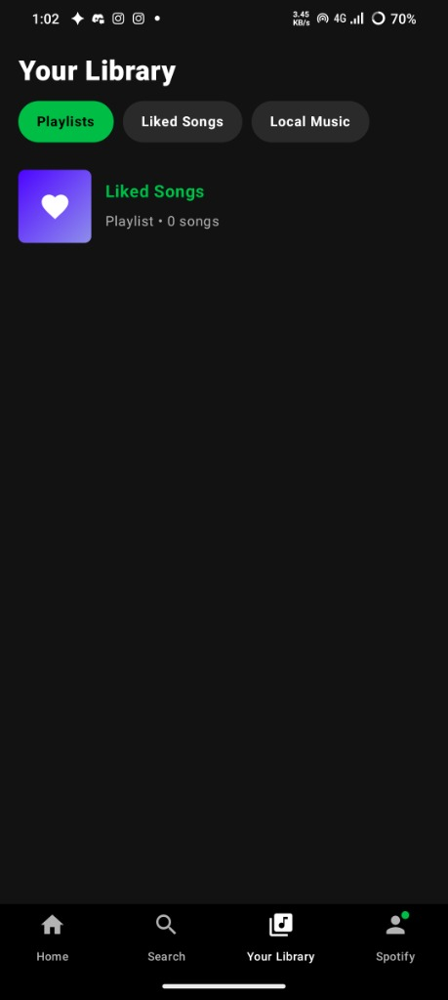
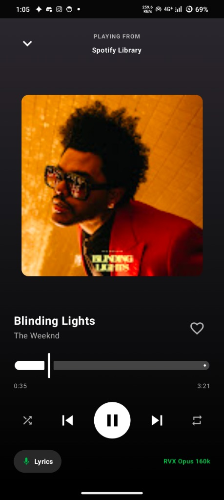
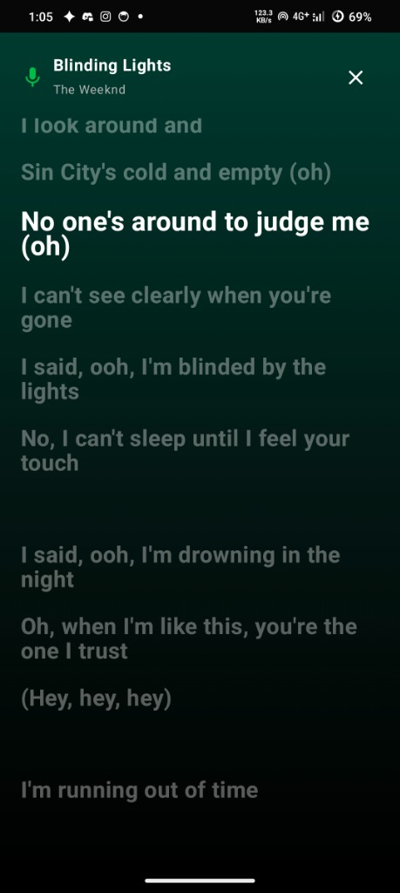
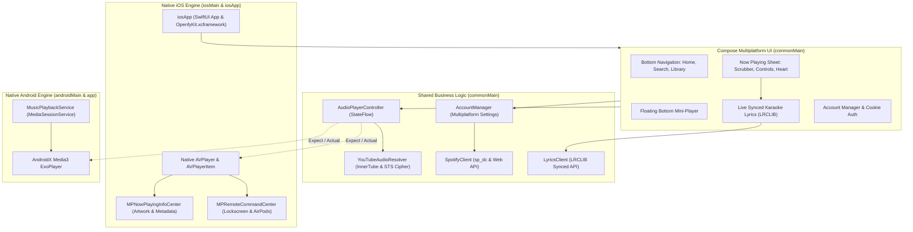

# Openfy 🎵

<p align="center">
  
</p>

<p align="center">
  <strong>A cross-platform music streaming application for Android and iOS, looking just like Spotify with the power of RVX YouTube Music under the hood.</strong>
</p>

<p align="center">
  <a href="https://github.com/Zcross091/Openfy/actions/workflows/build.yml">
    
  </a>
  <a href="https://github.com/Zcross091/Openfy/actions/workflows/build-ios.yml">
    
  </a>
  <a href="https://github.com/Zcross091/Openfy/releases/latest">
    
  </a>
  
  
  
  
  <a href="LICENSE">
    
  </a>
</p>

---

## 📱 Visual Showcase & Live Preview

<p align="center">
  
  <br>
  <em>✨ Openfy running across mobile devices: Pixel-perfect 1:1 Spotify UI, high-efficiency streaming engine, and synced karaoke lyrics ✨</em>
</p>

| 🏠 1. Home Feed | 🔍 2. Search & Browse | 📚 3. Your Library | 🎵 4. Now Playing | 🎤 5. Synced Lyrics |
| :---: | :---: | :---: | :---: | :---: |
|  |  |  |  |  |
| *1:1 Spotify UI & top charts* | *Rich genre & category tiles* | *Playlists & Liked songs* | *High-fidelity stream & controls* | *Real-time karaoke highlighting* |

---

## 📥 Download & Install

<p align="center">
  <a href="https://github.com/Zcross091/Openfy/releases/latest/download/Openfy.apk">
    
  </a>
  &nbsp;&nbsp;
  <a href="https://github.com/Zcross091/Openfy/releases/latest/download/Openfy.ipa">
    
  </a>
</p>

* **Official Releases Hub**: [**All Openfy Releases**](https://github.com/Zcross091/Openfy/releases)
* **Latest Direct Android APK**: [**Openfy.apk**](https://github.com/Zcross091/Openfy/releases/latest/download/Openfy.apk)
* **Latest Direct iOS IPA**: [**Openfy.ipa**](https://github.com/Zcross091/Openfy/releases/latest/download/Openfy.ipa)

---

## 🍏 iOS Sideloading Guide

Openfy for iOS is distributed as an ad-hoc signed **`Openfy.ipa`** ready for universal sideloading on non-jailbroken and jailbroken devices alike. Choose any of the proven sideloading methods below:

### 1. AltStore / AltStore PAL (Recommended for most users)
1. Download **`Openfy.ipa`** from [Latest Releases](https://github.com/Zcross091/Openfy/releases/latest).
2. Open the **AltStore** app on your iPhone or iPad (connected to your computer running AltServer over Wi-Fi or USB).
3. Navigate to the **My Apps** tab and tap the **`+`** icon in the top left corner.
4. Select the downloaded `Openfy.ipa` file.
5. AltStore will sign the IPA with your Apple ID and install Openfy directly onto your home screen.
> *Note: Free Apple IDs require refreshing every 7 days via AltStore.*

### 2. SideStore (Untethered on-device sideloading)
1. Download **`Openfy.ipa`** on your device.
2. Turn on the **SideStore WireGuard VPN** on your iPhone.
3. Open **SideStore**, tap **`+`** in the Apps tab, and select `Openfy.ipa`.
4. SideStore signs and installs Openfy without needing a computer connection.

### 3. TrollStore (Permanent install – iOS 14.0 to 16.6.1 & 17.0)
1. Download **`Openfy.ipa`** in Safari or Files.
2. Tap the **Share** button and select **TrollStore** (or open TrollStore and tap **Install IPA File**).
3. Openfy is installed **permanently** without 7-day expirations, app limits, or revokes using the CoreTrust root entitlement bypass!

### 4. Sideloadly (Windows & macOS)
1. Download **`Openfy.ipa`** to your computer.
2. Connect your iOS device and launch **Sideloadly**.
3. Drag and drop `Openfy.ipa` into the Sideloadly window.
4. Enter your Apple ID and click **Start** to install.

### 5. Scarlet / Esign
1. Download `Openfy.ipa` on your iOS device.
2. Open Scarlet or Esign, import the IPA, and tap Install.

> [!NOTE]
> If prompted with *"Untrusted Developer"* upon first launch on iOS:  
> Go to **Settings > General > VPN & Device Management**, select your Apple ID profile, and tap **Trust**. On iOS 16+, ensure **Developer Mode** is enabled (**Settings > Privacy & Security > Developer Mode**).

---

## 🤖 Android Installation Guide

1. Download **`Openfy.apk`** from [Latest Releases](https://github.com/Zcross091/Openfy/releases/latest).
2. Open the APK on your Android device and tap **Install**.
3. If prompted, grant permission to *"Install unknown apps"*.

> [!TIP]
> **Seamless In-Place Updates**: Openfy Android APKs are signed with a persistent cryptographic release certificate. You can install newer APK versions directly over older ones without uninstalling or losing your cached data or login sessions!

---

## 🌟 Highlights & Features

* **🎨 1:1 Spotify User Interface**: Built with **Compose Multiplatform** and Material 3, shared 100% across Android and iOS. Exact Spotify dark palette (`#121212`, card `#181818`, hover `#282828`, green accent `#1DB954`), bottom navigation bar (`Home`, `Search`, `Your Library`), persistent floating mini-player, and full-screen now-playing sheet with animated playback scrubber.
* **⚡ RVX YouTube Music Streaming Engine**: Unrestricted audio extraction using YouTube Music's InnerTube API with STS cipher decryption:
  * **iOS**: Hardware-accelerated AAC-LC (128 kbps) stream selection optimized for Apple's native AVPlayer.
  * **Android**: High-efficiency Opus (160 kbps) and AAC streams.
  * Completely ad-free, unlimited skips, and no Spotify Premium or YouTube Premium required.
* **🎧 Native Background Playback & Lock Screen Controls**:
  * **iOS**: Native `AVPlayer` with `AVAudioSessionCategoryPlayback`. Full integration with `MPNowPlayingInfoCenter` (live artwork, title, artist, duration, playback rate, elapsed time) and `MPRemoteCommandCenter` (play, pause, toggle, scrubber seek, Control Center, lock screen, AirPods pinch, and Apple Watch / Bluetooth controls).
  * **Android**: `AndroidX Media3 (ExoPlayer)` running in a foreground `MediaSessionService` with lock-screen MediaStyle notification and audio focus management.
* **🔄 Single-Active-Account Paradigm**:
  * **Spotify Account**: Seamlessly sync your Liked Songs and playlists using your `sp_dc` cookie. Tapping the **Heart** icon instantly adds tracks to your real Spotify library (`PUT /v1/me/tracks`)!
  * **YouTube Music Account**: Access playlists and liked music.
  * **Guest / Free Mode**: Search global charts, stream any track, and browse genres without logging into anything.
* **🎤 Synchronized Karaoke Lyrics**: Fullscreen real-time synced lyrics with line-by-line autoscroll and tap-to-seek, powered by LRCLIB.

---

## 🏗️ Architecture

Openfy utilizes **Compose Multiplatform (CMP)** to share UI and core logic across platforms while delegating audio playback to each platform's native multimedia framework:



---

## 🛠️ Building From Source

### Prerequisites
* **JDK**: Java 21 (Eclipse Temurin recommended)
* **Gradle**: 8.12 (via included Gradle Wrapper `./gradlew`)
* **Android**: Android SDK Platform API 35
* **iOS**: macOS (macOS 14+ recommended), Xcode 16+

### 1. Build Android APK
```bash
# Debug build
./gradlew assembleDebug

# Release build
./gradlew assembleRelease
```
The compiled APK will be located at:
`app/build/outputs/apk/release/app-release.apk` (or `composeApp/build/outputs/apk/release/`)

### 2. Build iOS Shared XCFramework & IPA
```bash
# Step 1: Assemble shared Kotlin Multiplatform XCFramework
./gradlew :composeApp:assembleOpenfyKitReleaseXCFramework

# Step 2: Compile iOS App archive
xcodebuild archive \
  -project iosApp/iosApp.xcodeproj \
  -scheme iosApp \
  -configuration Release \
  -destination 'generic/platform=iOS' \
  -archivePath build/Openfy.xcarchive \
  CODE_SIGNING_ALLOWED=NO \
  CODE_SIGNING_REQUIRED=NO \
  CODE_SIGN_IDENTITY=""

# Step 3: Package & Ad-hoc sign IPA for sideloading
mkdir -p build/ipa/Payload
cp -R build/Openfy.xcarchive/Products/Applications/iosApp.app build/ipa/Payload/Openfy.app
cd build/ipa
codesign --force --deep --sign - Payload/Openfy.app
zip -qr ../../Openfy.ipa Payload
cd ../..
```
The resulting `Openfy.ipa` can be installed immediately via AltStore, SideStore, TrollStore, or Sideloadly.

---

## 📂 Project Structure

```
Openfy/
├── .github/
│   └── workflows/
│       ├── build.yml                 # Android CI/CD workflow (APK build & release)
│       └── build-ios.yml             # iOS CI/CD workflow (XCFramework, IPA, codesign & release)
├── composeApp/                       # Compose Multiplatform core
│   ├── build.gradle.kts              # CMP configuration (Android & iOS targets, XCFramework)
│   └── src/
│       ├── commonMain/kotlin/com/openfy/music/
│       │   ├── App.kt                # Root Compose Multiplatform App
│       │   ├── data/                 # Models, YouTube resolver, Spotify API, LRCLIB
│       │   ├── player/               # AudioPlayerController & PlaybackState
│       │   └── ui/                   # Screens, MiniPlayer, NowPlaying, Theme
│       ├── androidMain/kotlin/       # Android-specific actuals & ExoPlayer
│       └── iosMain/kotlin/           # iOS-specific actuals, AVPlayer & MPNowPlayingInfo
├── iosApp/                           # Native iOS Project
│   ├── iOSApp.swift                  # SwiftUI @main App entry point
│   ├── ContentView.swift             # UIViewControllerRepresentable bridge
│   ├── Info.plist                    # Background audio permissions & network security
│   └── iosApp.xcodeproj/             # Xcode project linking OpenfyKit.xcframework
├── app/                              # Android application module
│   ├── build.gradle.kts
│   └── src/main/AndroidManifest.xml
├── build.gradle.kts                  # Root Gradle build configuration
├── settings.gradle.kts               # Gradle project modules
└── gradle/
    └── libs.versions.toml            # Version catalog (CMP, Ktor, Coil 3, Kotlin)
```

---

## 🤝 Contributing

Contributions, issues, and feature requests are welcome!  
Please read through our [**Contributing Guidelines (CONTRIBUTING.md)**](CONTRIBUTING.md) to learn about setting up your local environment and submitting pull requests.

---

## 📜 License

This project is licensed under the [**MIT License**](LICENSE) - see the [LICENSE](LICENSE) file for details. Built for educational and personal research purposes.
