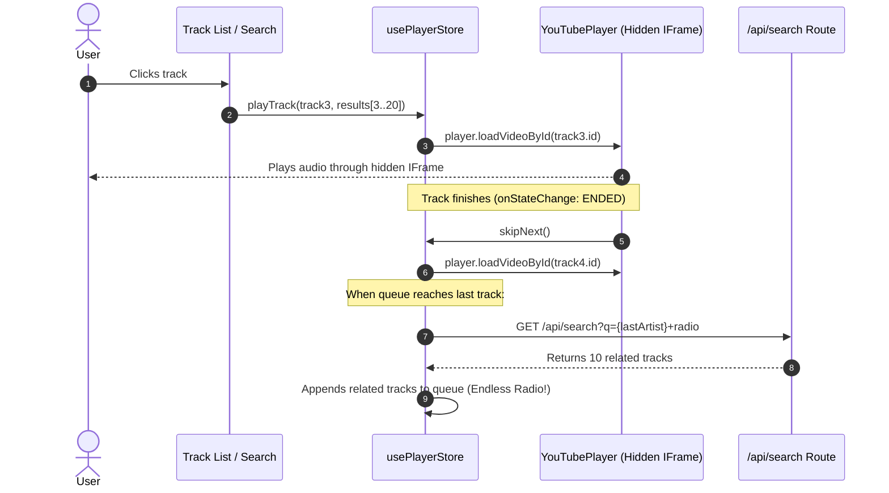

# Openfy Web - System Architecture

An open-source Spotify web client clone powered by **Next.js 15**, **Tailwind CSS**, **Zustand**, and a headless **YouTube IFrame** audio streaming engine.

---

## 1. High-Level Architecture Overview

```mermaid
graph TD
    User([User]) <--> UI[Spotify Web UI - Next.js 15 / Tailwind CSS]

    subgraph Presentation & State Layer
        UI <--> LeftNav[Left Sidebar Navigation: Home, Search, Liked Songs]
        UI <--> MainView[Main Content: Home Shelves / Search Results / Playlists]
        UI <--> RightBar[Right 'Now Playing' & 'Next in Queue' Unified Sidebar]
        UI <--> BottomPlayer[Bottom Playback Controls & Time Scrubber Bar]
        
        LeftNav & MainView & RightBar & BottomPlayer <--> ZStore[(Zustand Persisted Store: usePlayerStore)]
        ZStore <--> LocalStorage[(Browser LocalStorage: Liked Songs & Queue)]
    end

    subgraph Audio Engine Layer
        ZStore <--> YTWrapper[Custom Headless YouTube IFrame Wrapper Component]
        YTWrapper <--> YTIFrame[Hidden Off-Screen YouTube IFrame Player]
        YTIFrame <--> YTAudio[YouTube Audio Playback]
    end

    subgraph Search & Endless Radio Layer
        MainView <--> NextApi[/api/search Route Handler]
        ZStore -. Auto Radio End .- -> NextApi
        NextApi <--> YTDataApi[YouTube Data API v3]
        NextApi -. Fallback .-> PublicScraper[InnerTube Search Fallback Engine]
    end
```

---

## 2. Core Components & Responsibilities

### 2.1. State Management: Zustand Store (`usePlayerStore`)
The single source of truth for the entire client, with `persist` middleware saving Liked Songs, volume, and playback preferences to `localStorage`:
* **Playback State**:
  * `isPlaying: boolean`
  * `isBuffering: boolean`
  * `currentTime: number`
  * `duration: number`
  * `volume: number` (0–100)
  * `isMuted: boolean`
* **Queue & Track State**:
  * `currentTrack: Track | null`
  * `queue: Track[]`
  * `queueIndex: number`
  * `history: Track[]`
  * `likedSongs: Track[]`
* **Playback Modes**:
  * `isShuffle: boolean`
  * `repeatMode: 'off' | 'all' | 'one'`
  * `isRightSidebarOpen: boolean`
* **Core Actions**:
  * `playTrack(track: Track, newQueue?: Track[])`
  * `togglePlay()`
  * `skipNext()`: Advances to the next track. If the queue is depleted, triggers **Endless Radio** to search and append 10 related tracks automatically.
  * `skipPrev()`: Rewinds to start or plays previous track.
  * `seekTo(seconds: number)`
  * `setVolume(volume: number)`
  * `toggleLike(track: Track)`: Toggles Heart status and persists to `likedSongs` in `localStorage`.
  * `removeFromQueue(index: number)`
  * `jumpToQueueIndex(index: number)`
  * `toggleShuffle()`, `toggleRepeat()`, `toggleRightSidebar()`

---

### 2.2. Audio Engine: Headless YouTube IFrame API Wrapper (`YouTubePlayer`)
* **100% Client-Side Audio Streaming**: No server proxy or bandwidth cost.
* **Invisible Presentation**: Encapsulated in a fixed, off-screen container (`opacity: 0`, `pointer-events: none`, `width: 1px`, `height: 1px`).
* **IFrame API Integration**:
  * Dynamically loads `https://www.youtube.com/iframe_api`.
  * Binds to `window.YT.Player`.
  * Subscribes to `onStateChange`:
    * `PLAYING` (1) $\rightarrow$ updates `isPlaying = true`, triggers 500ms progress ticker.
    * `PAUSED` (2) $\rightarrow$ updates `isPlaying = false`.
    * `BUFFERING` (3) $\rightarrow$ updates `isBuffering = true`.
    * `ENDED` (0) $\rightarrow$ calls `skipNext()`. If repeat mode is `'one'`, loops current track; otherwise plays the next queue item.
* **Programmatic Command Bridge**:
  * Responds to `playTrack` by calling `player.loadVideoById(track.id)`.
  * Responds to `togglePlay` by calling `player.playVideo()` or `player.pauseVideo()`.
  * Responds to `seekTo` by calling `player.seekTo(seconds, true)`.
  * Responds to `setVolume` by calling `player.setVolume(volume)`.

---

### 2.3. Dual-Mode Search Route (`/api/search`)
* Next.js 15 Server Route (`web/src/app/api/search/route.ts`).
* **Priority 1 (API Key)**: If `YOUTUBE_API_KEY` is present in `.env.local`, queries YouTube Data API v3 (`https://www.googleapis.com/youtube/v3/search?part=snippet&type=video&videoCategoryId=10&maxResults=25&q=...`).
* **Priority 2 (Zero-Config Fallback)**: If no key is set or Google returns HTTP 403 (quota exceeded), falls back to InnerTube search scraper, ensuring the web app **never fails to search or stream**.
* Normalizes results into standardized `Track` objects:
  ```typescript
  export interface Track {
    id: string; // YouTube videoId
    title: string;
    artist: string;
    album?: string;
    coverUrl: string;
    durationSeconds: number;
    isLiked?: boolean;
  }
  ```

---

### 2.4. Spotify 1:1 UI Layout Hierarchy

```
+--------------------------------------------------------------------------------------------------+
|  [Logo] Openfy       | [ < ] [ > ]  [Search Input Bar]                      | [Profile / GitHub] |
+----------------------+------------------------------------------------------+--------------------+
|  HOME                | Home Feed:                                           | NOW PLAYING        |
|  SEARCH              | [ Today's Top Hits Shelf ]                           | [Large Cover Art]  |
|  YOUR LIBRARY        |  [Card 1] [Card 2] [Card 3] [Card 4] [Card 5]        | Track Title        |
|  - Liked Songs       |                                                      | Artist Name        |
|                      | Search Results (Table):                              |                    |
|  PLAYLISTS:          | #  Title                 Artist       Album     Time | NEXT IN QUEUE:     |
|  - RapCaviar         | 1  Blinding Lights       The Weeknd   After...  3:22 | 1. Save Your Tears |
|  - All Out 2020s     | 2  Starboy               The Weeknd   Starboy   3:50 | 2. Counting Stars  |
|  - Today's Top Hits  | 3  Save Your Tears       The Weeknd   After...  3:35 | 3. Shape of You    |
+----------------------+------------------------------------------------------+--------------------+
| [Cover] Title/Artist | [Shuffle] [Prev] [ PLAY/PAUSE ] [Next] [Repeat]      | [Queue] [Volume]   |
| [Heart Button]       | 01:23 ===================================== 03:22    |     =======|====   |
+--------------------------------------------------------------------------------------------------+
```

1. **Left Sidebar (`LeftSidebar.tsx`)**:
   * Navigation links: Home (`/`), Search (`/search`), Liked Songs (`/liked`).
   * Pinned playlists with instant filters.
2. **Main View Area (`page.tsx`, `search/page.tsx`, `liked/page.tsx`)**:
   * Spotify dark aesthetic (`bg-[#121212]`, cards `bg-[#181818]` with hover highlight `hover:bg-[#282828]`).
   * Interactive Track Table with hover play button, duration formatting, and Heart toggle.
3. **Unified Right Sidebar (`NowPlayingSidebar.tsx`)**:
   * **Top**: Large album cover art, song title, artist link.
   * **Bottom**: "Next In Queue" section displaying upcoming tracks with click-to-play and remove buttons.
4. **Bottom Player Bar (`BottomPlayer.tsx`)**:
   * Fixed at the bottom (`z-index: 50`, `bg-[#181818]`).
   * Left: Artwork, title, artist, Heart like button.
   * Center: Playback controls, draggable scrubber bar, time stamps.
   * Right: Queue sidebar toggle, Volume slider, Mute toggle.

---

## 3. Endless Radio & Auto-Queue Data Flow


